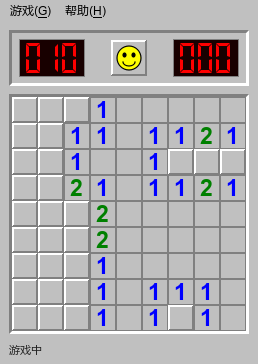

# Classic Minesweeper · 经典扫雷

Python + PyQt6 编写的经典 Windows 风格桌面扫雷。



## 功能

- 灰色立体方格、红色数码管、笑脸按钮与地雷图标。
- 初级（9×9 / 10 雷）、中级（16×16 / 40 雷）、高级（16×30 / 99 雷）。
- 首次点击及周围区域安全，空白区域自动展开。
- 首次点击时生成并验证“无猜测棋盘”：验证器仅根据可见数字、剩余雷数和集合差推理求解，拒绝需要猜测的候选局面。生成期间可重开或切换难度，计时在棋盘准备好后开始；达到尝试上限会提示重试，不会退回有死局的随机棋盘。该保证指存在纯逻辑通关路径，手动插错旗或主动点击未确认安全的格子仍可能失败。
- 右键插旗；点击已翻开的数字快速展开，插错旗仍可能踩雷。
- F2 或笑脸重开，支持左键插旗模式与分难度最佳成绩。
- “游戏 → 自动标雷”是可勾选开关，Ctrl+M 切换。开启后，每次翻开格子（包括空白展开、数字快速展开）自动标记能确定的地雷；新游戏和切换难度保留开关状态。与棋盘验证器共用数字、集合差、剩余总雷数推理，连续推理直到不能推出新雷。不猜测、不信任手动旗子、不自动翻格；旗子不足时保留原标记，请先取消错误旗子。
- “游戏 → 安全提示”或 Ctrl+H：用绿框指出逻辑可证的安全格，帮助处理被旗子隔开的角落和需要全局推理的局面。提示不读取隐藏雷区，也不会替你翻格。
- 对最多 22 个未知格的小型残局，会联合数字约束和剩余雷数检查所有可行布局，只采用所有布局都成立的结论。搜索达到预算时不返回不完整结论；没有确定雷但有安全格时，应先使用安全提示继续翻格。
- 窗口按棋盘实际尺寸固定，屏幕容纳不下时使用滚动条。

## 运行

需要 Python 3.14+ 和 uv。在项目根目录执行：

```powershell
uv sync
uv run classic-minesweeper
```

也可使用模块入口：

```powershell
uv run python -m classic_minesweeper
```

IDE 请使用项目虚拟环境，运行 `src/classic_minesweeper/__main__.py`。

## 项目结构

```text
classic-minesweeper/
├── src/classic_minesweeper/
│   ├── __init__.py      # 包信息
│   ├── __main__.py      # 模块与 IDE 启动入口
│   ├── app.py           # PyQt6 界面、绘制、计时和窗口适配
│   └── model.py         # 不依赖 GUI 的游戏规则
├── tests/test_model.py  # 规则测试
├── docs/images/         # 游戏截图与图标预览
├── pyproject.toml       # 项目元数据和命令入口
└── uv.lock             # 依赖版本锁定
```

## 测试

规则测试无需安装 PyQt6：

```powershell
python -m unittest discover -s tests -v
```

使用 uv：

```powershell
uv run python -m unittest discover -s tests -v
```
